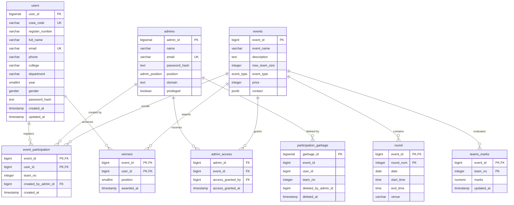

# Sync '26 — Backend Architecture & Module Documentation

This document provides a comprehensive, production-grade technical specification of the **Sync '26** backend service (`sync-backend-26`). It covers system architecture, database models, security mechanisms, worker pipelines, and detailed module-by-module documentation.

---

## Table of Contents

1. [System Architecture & Overview](#1-system-architecture--overview)
2. [Environment Configuration & Deployment](#2-environment-configuration--deployment)
3. [Database Design & Schema (`src/db/`)](#3-database-design--schema-srcdb)
4. [Module 1: Authentication & User Management (`auth`)](#4-module-1-authentication--user-management-auth)
5. [Module 2: Admin Core Management (`admin`)](#5-module-2-admin-core-management-admin)
6. [Module 3: Events Module — Public Access (`events.public`)](#6-module-3-events-module--public-access-eventspublic)
7. [Module 4: Events Module — Event Desk Administration (`events.admin`)](#7-module-4-events-module--event-desk-administration-eventsadmin)
8. [Module 5: Events Module — Superadmin Governance (`events.superadmin`)](#8-module-5-events-module--superadmin-governance-eventssuperadmin)
9. [Module 6: Certificate Generation & Verification (`certificate`)](#9-module-6-certificate-generation--verification-certificate)
10. [Module 7: Asynchronous Background Workers (`workers`)](#10-module-7-asynchronous-background-workers-workers)
11. [Module 8: Shared Utilities, Middleware & Error Handling](#11-module-8-shared-utilities-middleware--error-handling)
12. [Testing, Benchmarking & Database Seeding](#12-testing-benchmarking--database-seeding)

---

## 1. System Architecture & Overview

### 1.1 Technology Stack

| Layer | Technology | Version | Purpose |
|---|---|---|---|
| **Runtime** | Node.js / TypeScript | Node 18+ / TS 5.9.3 | Execution environment and static type safety |
| **HTTP Framework** | Express.js | 5.2.1 | HTTP routing, REST API lifecycle, middleware dispatching |
| **ORM / Query Builder** | Drizzle ORM | 0.45.2 | Type-safe SQL schema definition and query execution |
| **Database Driver** | `pg` (node-postgres) | 8.23.0 | PostgreSQL client with custom pooling configurations |
| **Database** | PostgreSQL (Supabase) | 15+ | Relational data persistence with connection pooling |
| **Job Queue** | `graphile-worker` | 0.17.3 | PostgreSQL-native async job queue via `LISTEN/NOTIFY` (No Redis required) |
| **In-Memory Caching** | `lru-cache` | 11.5.2 | Transient state staging (registration/OTP) and read cache |
| **Email Delivery** | ZeptoMail Client | 8.0.1 | Transactional email transmission via REST API |
| **PDF Generation** | `pdf-lib` | 1.17.1 | In-memory programmatic PDF templating & coordinate rendering |
| **QR Code Engine** | `qrcode` | 1.5.4 | In-memory PNG QR buffer generation for tickets |
| **Validation** | Zod | 4.4.3 | Runtime request body, query, and parameter schema parsing |
| **Security** | Helmet, Bcrypt, JWT | 8.3.0 / 6.0.0 / 9.0.3 | Header hardening, cryptographic password hashing, auth tokens |

### 1.2 Architectural Topology

```
                       ┌───────────────────────────────┐
                       │   Reverse Proxy / Gateway     │
                       │  (Render / Vercel / Nginx)    │
                       └──────────────┬────────────────┘
                                      │ HTTPS
                                      ▼
                       ┌───────────────────────────────┐
                       │     Express 5.2.1 Server      │
                       │    (Trust Proxy, Helmet,      │
                       │     CORS, Rate Limiting)      │
                       └───────┬──────────────┬────────┘
                               │              │
        ┌──────────────────────┘              └──────────────────────┐
        ▼                                                            ▼
┌───────────────────────────────┐                  ┌───────────────────────────────┐
│   Synchronous HTTP Pipeline   │                  │   In-Memory Cache & Mutex     │
│   - Controllers               │                  │   - Registration LRU (5k, 5m) │
│   - Services                  │                  │   - Forgot-Password LRU (10m) │
│   - Zod Validators            │                  │   - Double-Submit Mutex (Set) │
│   - JWT Auth Cookie / Bearer  │                  │   - Events Read-Through LRU   │
└──────────────┬────────────────┘                  └───────────────────────────────┘
               │
               ├──────────────────────────────────────────────┐
               │                                              │
               ▼                                              ▼
┌───────────────────────────────────────┐   ┌───────────────────────────────────┐
│ Supabase Transaction Pooler (Port 6543)│   │ Supabase Session Pooler (Port 5432)│
│ Max Connections: 200                  │   │ Max Connections: 6                │
│ Used for: Express API CRUD queries    │   │ Used for: Graphile Worker Runner  │
│ High concurrency, stateless           │   │ Requires persistent LISTEN/NOTIFY │
└──────────────────┬────────────────────┘   └─────────────────┬─────────────────┘
                   │                                          │
                   └──────────────────┬───────────────────────┘
                                      ▼
                        ┌───────────────────────────┐
                        │   PostgreSQL Database     │
                        │   - Core Business Tables  │
                        │   - graphile_worker Schema│
                        │   - Sequences & Triggers  │
                        └─────────────┬─────────────┘
                                      │
                                      ▼
                        ┌───────────────────────────┐
                        │ Graphile Worker Runner    │
                        │ Concurrency: 3            │
                        │ Tasks:                    │
                        │  - send-otp               │
                        │  - generate-ticket        │
                        └─────────────┬─────────────┘
                                      │
                                      ▼
                        ┌───────────────────────────┐
                        │      ZeptoMail API        │
                        │  Transactional Delivery   │
                        └───────────────────────────┘
```

### 1.3 Key Architectural Patterns

1. **Dual Supabase Connection Strategy**:
   - **Transaction Pooler (Port 6543)**: Allocated `max: 200` connections. Handles all standard REST queries via Drizzle. Enables high concurrency without running out of server connections.
   - **Session Pooler (Port 5432)**: Allocated `max: 6` connections. Exclusively dedicated to `graphile-worker` because background task polling and event notification rely on PostgreSQL `LISTEN/NOTIFY`, which fails on transaction poolers.
2. **Stateless Registration Staging (Zero-Zombie Users)**:
   - When a user registers, no row is written to PostgreSQL until OTP validation succeeds.
   - All user input + pre-hashed password + 6-digit OTP are staged inside an LRU Cache with a 5-minute TTL.
   - Once verified, the user is promoted into PostgreSQL in a single insert. This completely prevents database pollution from unverified sign-ups.
3. **Double-Submit & Race Prevention**:
   - A synchronous in-process `Set<string>` mutex locks the user's email during verification so concurrent requests cannot create duplicate accounts.
4. **Isolated Security Contexts**:
   - Standard Users and Admins share the primary `JWT_SECRET`.
   - Certificate Admins use a separate `CERTIFICATE_ADMIN_JWT_SECRET` and distinct middleware to avoid privilege elevation.
5. **In-Memory Streaming Output**:
   - QR codes and Certificate PDFs are generated and streamed entirely in RAM. No temporary files are written to disk.

---

## 2. Environment Configuration & Deployment

### 2.1 Environment Variables Reference

| Variable | Type | Default | Description |
|---|---|---|---|
| `PORT` | Number | `5000` | Port on which the HTTP server listens (`127.0.0.1`). |
| `NODE_ENV` | String | `development` | Environment mode (`development`, `production`, `test`). |
| `DATABASE_URL` | String | Required | PostgreSQL connection string (Transaction pooler on port 6543). |
| `WORKER_DATABASE_URL` | String | Optional | PostgreSQL connection string (Session pooler on port 5432). Defaults to `DATABASE_URL` if omitted. |
| `JWT_SECRET` | String | Required | Secret string used to sign and verify user and admin JWTs. |
| `CERTIFICATE_ADMIN_JWT_SECRET` | String | Falls back to `JWT_SECRET` | Isolated secret string used strictly for certificate admin JWTs. |
| `CERT_ADMIN` | String | `admin` | Hardcoded username for the Certificate Management Admin. |
| `CERT_ADMIN_PW` | String | `admin123` | Hardcoded password for the Certificate Management Admin. |
| `ZEPTOMAIL_URL` | String | `https://api.zeptomail.in/v1.1/email` | Endpoint for the ZeptoMail REST API. |
| `ZEPTOMAIL_TOKEN` | String | Required | Authorization token issued by ZeptoMail. |
| `ZEPTOMAIL_SENDER_ADDRESS` | String | `noreply@cseaceg.org.in` | Sender email address registered with ZeptoMail. |
| `ZEPTOMAIL_SENDER_NAME` | String | `noreply` | Display name of the email sender. |
| `FRONTEND_URL` | String | `http://localhost:5173` | Allowed CORS origin for web applications. |

### 2.2 Server Bootstrap & Graceful Shutdown

Server bootstrap and shutdown are handled in `src/server.ts`:

- **Bootstrap Lifecycle**:
  1. Initializes `graphile-worker` runner and its schema tables.
  2. Binds Express HTTP listener to `127.0.0.1:PORT`.
  3. Registers signal hooks for `SIGTERM` and `SIGINT`.
- **Graceful Shutdown**:
  1. Closes HTTP listener to cease accepting new connections while completing in-flight requests.
  2. Invokes `shutdownWorker()` to drain and stop the background runner.
  3. Calls `pool.end()` on the main database connection pool.
  4. Exits process with code `0`.

---

## 3. Database Design & Schema (`src/db/`)

The database schema is defined with Drizzle ORM in `src/db/schema.ts`.

### 3.1 Entity Relationship Diagram



### 3.2 Enums and Tables Detailed Breakdown

#### Enums
- `gender`: `'Male'`, `'Female'`, `'Other'`
- `admin_position`: `'Executive'`, `'Office Bearer'`, `'Joint Secretary'`, `'Co-ordinator'`
- `event_type`: `'Tech'`, `'Non-Tech'`

#### Table: `users`
- Stores individual student participant profiles.
- `csea_code`: Unique 6-character identifier (format: `[A-Z]{2}\d{4}`) assigned by the database trigger or generation script upon verified registration.
- `register_number`: College registration / roll number (up to 30 characters).
- `year`: Numeric year of study (1 to 5).

#### Table: `admins`
- Stores event administrators, office bearers, and faculty coordinators.
- `privileged`: Boolean flag. When `true`, user is treated as **Superadmin** and bypasses specific event access checks.

#### Table: `events`
- Master table defining technical and non-technical competitions.
- `max_team_size`: Maximum allowed members per team.
- `contact`: JSONB field containing contact coordinators (`[{ name, phone, role }]`).

#### Table: `round`
- Composite Primary Key: `(event_id, round_num)`.
- Foreign Key: `event_id -> events.event_id`.
- Stores timetable and venue scheduling for each progressive competition round.

#### Table: `admin_access`
- Junction table managing granular event-desk permissions for non-privileged admins.
- Unique constraint on `(admin_id, event_id)`.
- Tracks `access_granted_by` (FK to `admins`) and `access_granted_at`.

#### Table: `event_participation`
- Composite Primary Key: `(event_id, user_id)`.
- Links users registered for events.
- `team_no`: Integer group number drawn atomically from PostgreSQL sequence `team_no_seq`.
- Tracks `created_by_admin_id`.

#### Table: `participation_garbage`
- Soft-delete and audit trail table.
- When an admin deletes a participant or an entire team, rows are archived here with `deleted_by_admin_id` and `deleted_at` before deletion from `event_participation`.

#### Table: `winners`
- Composite Primary Key: `(event_id, user_id)`.
- `position`: Smallint (1 = 1st Place, 2 = 2nd Place, 3 = 3rd Place).
- Stores the official awarded standings used for Certificate of Appreciation generation.

#### Table: `teams_marks`
- Composite Primary Key: `(event_id, team_no)`.
- `marks`: Numeric `(5, 2)` score awarded to the team during rounds.
- Foreign Key with `onDelete("cascade")` linking to `events.event_id`.

---

## 4. Module 1: Authentication & User Management (`auth`)

This module oversees user signup, session creation, profile synchronization, password reset workflows, and test harness execution.

### 4.1 Architecture & Flow

```
[Client] ──(1) POST /register/initiate ──► [Rate Limiter (10/min)]
                                                    │
                                                    ▼
                                            [Registration Service]
                                             ├─ Check duplicate email in DB
                                             ├─ Hash password upfront (Bcrypt 10)
                                             ├─ Generate 6-digit OTP
                                             ├─ Cache in LRU (5-min TTL)
                                             └─ Add 'send-otp' job to Worker
                                                    │
                                                    ▼
                                            [ZeptoMail Delivery]

[Client] ──(2) POST /register/verify ────► [Registration Service]
                                             ├─ Double-submit Mutex check
                                             ├─ Timing-safe OTP compare
                                             ├─ 3-strike lockout guard
                                             ├─ Promote to DB 'users' table
                                             └─ Return generated csea_code
```

### 4.2 Endpoints Specification

#### 1. Initiate Registration
- **Route**: `POST /api/v1/register/initiate`
- **Access**: Public (Rate-limited: 10 requests / 1-minute window per IP)
- **Request Body**:
  ```json
  {
    "register_number": "2024103001",
    "full_name": "Jane Doe",
    "email": "jane@example.com",
    "phone": "9876543210",
    "college": "College of Engineering, Guindy",
    "department": "Computer Science and Engineering",
    "year": 3,
    "gender": "Female",
    "password": "Password@123"
  }
  ```
- **Responses**:
  - `200 OK`: `{ "success": true, "message": "OTP sent to your email" }`
  - `400 Bad Request`: Email already registered, or validation error.
  - `429 Too Many Requests`: Rate limit reached.

#### 2. Verify Registration
- **Route**: `POST /api/v1/register/verify`
- **Access**: Public
- **Request Body**:
  ```json
  {
    "email": "jane@example.com",
    "otp": "492810"
  }
  ```
- **Responses**:
  - `200 OK`:
    ```json
    {
      "success": true,
      "message": "Registration successful",
      "data": { "cseaCode": "CS1042" }
    }
    ```
  - `400 Bad Request`: Invalid OTP (remaining attempts indicated), or session expired.
  - `409 Conflict`: Verification already in progress.

#### 3. User Login
- **Route**: `POST /api/v1/auth/login`
- **Access**: Public
- **Request Body**: `{ "email": "jane@example.com", "password": "Password@123" }`
- **Actions**:
  - Validates credentials against `users` table via `bcrypt.compare`.
  - Signs JWT payload: `{ user_id, email, role: "user" }` (Expires: 7 days).
  - Sets HTTP-only cookie named `auth_token`.
- **Response**:
  - `200 OK`:
    ```json
    {
      "success": true,
      "message": "Login successful",
      "data": {
        "token": "eyJhbGciOiJIUzI1NiIsIn...",
        "user": {
          "csea_code": "CS1042",
          "register_number": "2024103001",
          "full_name": "Jane Doe",
          "email": "jane@example.com",
          "phone": "9876543210",
          "college": "College of Engineering, Guindy",
          "department": "Computer Science and Engineering",
          "year": 3,
          "gender": "Female"
        }
      }
    }
    ```

#### 4. User Logout
- **Route**: `POST /api/v1/auth/logout`
- **Access**: Public
- **Action**: Clears `auth_token` cookie.
- **Response**: `200 OK`: `{ "success": true, "message": "Logout successful" }`

#### 5. Forgot Password — Request OTP
- **Route**: `POST /api/v1/auth/getOTP`
- **Access**: Public
- **Request Body**: `{ "email": "jane@example.com" }`
- **Action**: Generates 6-digit OTP, stores in `forgotPasswordCache` (10-minute TTL), dispatches worker job. The raw OTP is never returned in the HTTP response.
- **Response**: `200 OK`: `{ "success": true, "message": "OTP sent successfully" }`

#### 6. Forgot Password — Verify OTP
- **Route**: `POST /api/v1/auth/verifyOTP`
- **Access**: Public
- **Request Body**: `{ "email": "jane@example.com", "otp": "583921" }`
- **Action**: Timing-safe verification; on success issues a 5-minute reset token containing `{ email, scope: "password_reset" }`.
- **Response**:
  - `200 OK`:
    ```json
    {
      "success": true,
      "message": "OTP verified successfully",
      "data": { "resetToken": "eyJhbGciOiJIUzI1NiIsIn..." }
    }
    ```

#### 7. Forgot Password — Reset Execution
- **Route**: `POST /api/v1/auth/forgetPassword`
- **Access**: Public (requires valid reset token)
- **Request Body**:
  ```json
  {
    "reset_token": "eyJhbGciOiJIUzI1NiIsIn...",
    "newPassword": "NewStrongPassword@2026"
  }
  ```
- **Response**: `200 OK`: `{ "success": true, "message": "Password reset successful" }`

#### 8. Change Password (Authenticated)
- **Route**: `POST /api/v1/auth/changePassword`
- **Access**: Authenticated (`protect`, `authorize('user')`)
- **Request Body**: `{ "oldPassword": "Password@123", "newPassword": "NewStrongPassword@2026" }`

#### 9. Current User Profile
- **Route**: `GET /api/v1/auth/me`
- **Access**: Authenticated (`protect`, `authorize('user')`)
- **Response**: User profile without exposing `password_hash` or internal `user_id`.

#### 10. Update Profile
- **Route**: `PUT /api/v1/auth/profile`
- **Access**: Authenticated (`protect`, `authorize('user')`)
- **Allowed Fields**: `full_name`, `phone`, `college`, `department`, `year`, `gender`.

#### 11. Profile by CSEA Code
- **Route**: `GET /api/v1/auth/profile/:csea_code`
- **Access**: Authenticated (`protect`, `authorize('user', 'admin')`). Admins can query any code; users can only query their own code.

---

## 5. Module 2: Admin Core Management (`admin`)

Provides identity, authentication, and session management for symposium staff, domain leads, and executive committee members.

### 5.1 Architecture & Role Permissions

The admin entity contains a `privileged` boolean flag:
- `privileged = false`: Regular event coordinator. Restricted to events explicitly mapped in `admin_access`.
- `privileged = true`: Superadmin. Has global visibility over all events, system statistics, and admin delegation.

### 5.2 Endpoints Specification

#### 1. Admin Login
- **Route**: `POST /api/v1/admin/login`
- **Access**: Public
- **Request Body**:
  ```json
  {
    "email": "executive.csea@ceg.edu",
    "password": "AdminSecurePassword#26"
  }
  ```
- **Action**:
  - Validates credentials against `admins` table.
  - Signs JWT payload:
    ```typescript
    {
      admin_id: number;
      email: string;
      role: "admin";
      privileged: boolean;
    }
    ```
  - Attaches `auth_token` cookie and returns user metadata.
- **Response**:
  - `200 OK`:
    ```json
    {
      "success": true,
      "message": "Admin login successful",
      "data": {
        "token": "eyJhbGciOiJIUzI1NiIsIn...",
        "user": {
          "admin_id": 4,
          "name": "Karthik Raja",
          "email": "executive.csea@ceg.edu",
          "position": "Executive",
          "domain": "Technical",
          "privileged": true,
          "role": "admin"
        }
      }
    }
    ```

#### 2. Admin Logout
- **Route**: `POST /api/v1/admin/logout`
- **Access**: Public
- **Response**: `200 OK`: `{ "success": true, "message": "Admin logout successful" }`

#### 3. Current Admin Identity
- **Route**: `GET /api/v1/admin/me`
- **Access**: Authenticated (`protect`, `authorize('admin')`)
- **Response**: Current admin's profile data.

---

## 6. Module 3: Events Module — Public Access (`events.public`)

Handles public viewing of events, scheduling details, and personal registrations.

### 6.1 Performance Optimizations
- **In-Memory Caching**: `getAllEvents()` caches the complete event list with nested rounds in an LRU cache (`ttl: 5 minutes`).
- **Promise Deduplication**: Uses `allEventsPromise` to collapse multiple concurrent requests into a single database query during cache misses (preventing cache stampedes).

### 6.2 Endpoints Specification

#### 1. List All Events
- **Route**: `GET /api/v1/events`
- **Access**: Public
- **Response**:
  ```json
  {
    "success": true,
    "count": 12,
    "data": [
      {
        "event_id": 101,
        "event_name": "Code Clash",
        "description": "Competitive coding marathon across 3 progressive tiers.",
        "max_team_size": 2,
        "event_type": "Tech",
        "prize": 10000,
        "contact": [
          { "name": "Arun Kumar", "phone": "9876543211", "role": "Lead" }
        ],
        "rounds": [
          {
            "event_id": 101,
            "round_num": 1,
            "date": "2026-09-25",
            "start_time": "10:00:00",
            "end_time": "11:30:00",
            "venue": "Ada Lovelace Hall"
          }
        ]
      }
    ]
  }
  ```

#### 2. Get Single Event Details
- **Route**: `GET /api/v1/events/:event_id`
- **Access**: Public
- **Response**: Complete event object with ordered round timetable.

#### 3. Get Registered Events for Participant
- **Route**: `GET /api/v1/events/participant/:csea_code`
- **Access**: Authenticated (`protect`, `authorize('user', 'admin')`)
- **Behavior**: Resolves user by CSEA code, verifies requesting identity (user matches token or token is admin), joins `event_participation` with `events`.
- **Response**:
  ```json
  {
    "success": true,
    "data": {
      "participant": {
        "csea_code": "CS1042",
        "full_name": "Jane Doe",
        "register_number": "2024103001"
      },
      "registered_events": [
        {
          "event_id": 101,
          "event_name": "Code Clash",
          "team_no": 12,
          "registered_at": "2026-09-25T05:30:00.000Z"
        }
      ]
    }
  }
  ```

---

## 7. Module 4: Events Module — Event Desk Administration (`events.admin`)

Equips on-ground event desk coordinators to verify students, register teams, record marks, and manage participant rosters.

### 7.1 Key Validation Rules
1. **Team Size Ceiling**: Submitted `csea_codes.length` cannot exceed `event.max_team_size`.
2. **Double Registration Prevention**: A participant cannot be registered twice for the same event.
3. **Roll Number Clash Prevention**: A student roll number (`register_number`) cannot register again under a different identity or team for the same event.
4. **Sequence-driven Team Numbers**: Distinct integer team numbers are generated via `nextval('team_no_seq')`.
5. **Garbage Archival**: Removed participants or teams are archived in `participation_garbage` before deletion.

### 7.2 Endpoints Specification

#### 1. Lookup Participant by CSEA Code
- **Route**: `GET /api/v1/admin/participant/:csea_code`
- **Access**: Authenticated (`protect`, `authorize('admin')`)

#### 2. Get Assigned Events
- **Route**: `GET /api/v1/admin/events`
- **Access**: Authenticated (`protect`, `authorize('admin')`)
- **Behavior**: Returns all events if `privileged === true`; otherwise queries `admin_access` filtered by `admin_id`.

#### 3. Get Event Participants Roster
- **Route**: `GET /api/v1/admin/events/:event_id/participants`
- **Access**: Authenticated (`protect`, `authorize('admin')`)
- **Response**: List of all enrolled participants with team numbers, contact info, and registration timestamps.

#### 4. Add Team of Participants
- **Route**: `POST /api/v1/admin/events/:event_id/participants`
- **Access**: Authenticated (`protect`, `authorize('admin')`)
- **Request Body**:
  ```json
  {
    "csea_codes": ["CS1042", "IT2031"]
  }
  ```
- **Responses**:
  - `201 Created`:
    ```json
    {
      "success": true,
      "message": "Participants added successfully",
      "data": {
        "event": { "event_id": 101, "event_name": "Code Clash" },
        "team_no": 14,
        "added": [
          { "csea_code": "CS1042", "full_name": "Jane Doe" },
          { "csea_code": "IT2031", "full_name": "John Smith" }
        ]
      }
    }
    ```
  - `400 Bad Request`: Team size exceeds maximum limit.
  - `404 Not Found`: One or more CSEA codes do not exist.
  - `409 Conflict`: Participant or student roll number is already registered for this event.

#### 5. Remove Individual Participant
- **Route**: `DELETE /api/v1/admin/events/:event_id/participant`
- **Access**: Authenticated (`protect`, `authorize('admin')`)
- **Request Body**: `{ "csea_code": "CS1042" }`

#### 6. Remove Entire Team
- **Route**: `DELETE /api/v1/admin/events/:event_id/team/:team_no`
- **Access**: Authenticated (`protect`, `authorize('admin')`)

#### 7. Upsert Team Marks
- **Route**: `PUT /api/v1/admin/events/:event_id/team/:team_no/marks`
- **Access**: Authenticated (`protect`, `authorize('admin')`)
- **Request Body**: `{ "marks": 87.50 }`
- **Behavior**: Inserts or updates marks in `teams_marks` with timestamp.

#### 8. Get All Team Marks for Event
- **Route**: `GET /api/v1/admin/events/:event_id/marks`
- **Access**: Authenticated (`protect`, `authorize('admin')`)

---

## 8. Module 5: Events Module — Superadmin Governance (`events.superadmin`)

Enables high-level administrative governance, admin role delegation, and real-time analytical reporting.

### 8.1 Assertion Guard
Every controller method in this module invokes `assertSuperAdmin(adminId, privileged)`, returning `403 Forbidden` if `privileged !== true`.

### 8.2 Endpoints Specification

#### 1. System-Wide Analytics & Metrics
- **Route**: `GET /api/v1/superadmin/stats`
- **Access**: Superadmin only
- **Response Structure**:
  ```json
  {
    "success": true,
    "data": {
      "summary": {
        "total_events": 14,
        "total_participations": 1250,
        "total_unique_participants": 780,
        "total_users_registered": 920,
        "total_teams": 610,
        "total_rounds": 32,
        "tech_events_count": 8,
        "non_tech_events_count": 6,
        "tech_participations": 800,
        "non_tech_participations": 450,
        "tech_teams": 390,
        "non_tech_teams": 220
      },
      "round_summary": {
        "total_rounds": 32,
        "events_by_round_count": { "2 Rounds": 8, "3 Rounds": 6 },
        "venues": [
          { "venue": "Ada Lovelace Hall", "count": 12 },
          { "venue": "Turing Lab", "count": 20 }
        ]
      },
      "events": [
        {
          "event_id": 101,
          "event_name": "Code Clash",
          "event_type": "Tech",
          "participation_count": 120,
          "team_count": 60,
          "rounds_count": 3,
          "admin_count": 4,
          "winner_count": 3,
          "rounds": []
        }
      ]
    }
  }
  ```

#### 2. List All System Administrators
- **Route**: `GET /api/v1/superadmin/admins`
- **Access**: Superadmin only

#### 3. List Admins Assigned to Event
- **Route**: `GET /api/v1/superadmin/events/:event_id/admins`
- **Access**: Superadmin only

#### 4. Assign Admin to Event
- **Route**: `POST /api/v1/superadmin/events/:event_id/admin`
- **Access**: Superadmin only
- **Request Body**: `{ "admin_id": 8 }`

#### 5. Revoke Admin from Event
- **Route**: `DELETE /api/v1/superadmin/events/:event_id/admin`
- **Access**: Superadmin only
- **Request Body**: `{ "admin_id": 8 }`

---

## 9. Module 6: Certificate Generation & Verification (`certificate`)

Manages the digital certificate lifecycle for competition winners and attendees.

### 9.1 PDF Rendering Architecture (`pdf.service.ts`)

Certificates are produced dynamically by modifying existing high-resolution vector PDF templates in memory:
- **Templates**: Located in `Cert-new/`:
  - `SYNC_Certificates_2026-app.pdf` (Certificate of Appreciation)
  - `SYNC_Certificates_2026-part.pdf` (Certificate of Participation)
- **Geometry & Coordinate System**:
  - Dimensions: `842.25 pt x 595.5 pt` (Standard A4 Landscape).
  - Clean Embedded Render: Embedded via `pdfDoc.embedPages()` onto a fresh document to avoid inheriting dirty canvas graphics state.
  - Coordinate Precision: Text coordinates align with template underline baselines.

```
Coordinate Metrics Table:

1. Appreciation Template:
   - Name Blank:       x: 293.0 pt -> 733.5 pt, y: 238.0 pt
   - Dept/Year Blank:  x: 87.5 pt  -> 410.5 pt, y: 206.5 pt
   - Position Blank:   x: 506.0 pt -> 671.0 pt, y: 206.5 pt
   - Event Blank:      x: 68.5 pt  -> 447.0 pt, y: 175.0 pt

2. Participation Template:
   - Name Blank:       x: 329.5 pt -> 763.0 pt, y: 245.0 pt
   - Dept/Year Blank:  x: 53.8 pt  -> 205.1 pt, y: 213.5 pt
   - Event Blank:      x: 422.0 pt -> 786.5 pt, y: 213.5 pt
```

- **Dynamic Auto-Fitting**:
  - Base font size: `17.5 pt` Helvetica-Bold.
  - Iteratively measures text width against available space. If text exceeds bounds, scales down by `0.5 pt` decrements until it fits.
- **Department Normalization**: Automatically converts full department strings into standard abbreviations (e.g., `"Computer Science and Engineering"` -> `"CSE - 3rd YEAR"`).

### 9.2 Certificate Endpoints

#### 1. Certificate Admin Login
- **Route**: `POST /api/v1/admin/certificate/login`
- **Access**: Public
- **Request Body**: `{ "username": "certadmin", "password": "securepassword" }`
- **Behavior**: Evaluates credentials directly against `CERT_ADMIN` and `CERT_ADMIN_PW` env vars. Signs isolated token with `CERTIFICATE_ADMIN_JWT_SECRET`.

#### 2. Record Event Winner
- **Route**: `POST /api/v1/admin/certificate/winners`
- **Access**: Authenticated (`protectCertificateAdmin`)
- **Request Body**:
  ```json
  {
    "csea_code": "CS1042",
    "event_id": 101,
    "position": 1
  }
  ```

#### 3. List All Recorded Winners
- **Route**: `GET /api/v1/admin/certificate/winners`
- **Access**: Authenticated (`protectCertificateAdmin`)

#### 4. Admin Direct Certificate Download
- **Route**: `GET /api/v1/admin/certificate/download?csea_code=CS1042&event_id=101&type=winner`
- **Access**: Authenticated (`protectCertificateAdmin`)
- **Response**: Streams binary `application/pdf`.

#### 5. List User Certificates (Public / User Dashboard)
- **Route**: `GET /api/v1/users/:csea_code/certificates`
- **Access**: Authenticated (`protect`, `authorize('user')`)
- **Response**: Returns array of both earned `Appreciation` and `Participation` certificates.

#### 6. User Download Certificate
- **Route**: `GET /api/v1/certificates/download?cseaCode=CS1042&eventId=101&type=winner`
- **Access**: Authenticated (`protect`, `authorize('user')`)
- **Guard**: Verifies user holds valid winner/participation record before streaming. Returns `403 Forbidden` if unauthorized.

---

## 10. Module 7: Asynchronous Background Workers (`workers`)

The background task engine is powered by `graphile-worker`, executing asynchronous workloads backed by PostgreSQL tables in the `graphile_worker` schema.

### 10.1 Worker Initialization & Connection Budget
Configured in `src/workers/index.ts`:
- Connection Budget (Session Pooler): Max 6 pool size.
  - 3 Concurrent workers
  - 1 `LISTEN/NOTIFY` client
  - 1 `workerUtils` client
  - 1 Headroom buffer
- Polling Interval: `1000ms`.

### 10.2 Task Definitions

#### Task: `send-otp` (`src/workers/tasks/send-otp.ts`)
- **Payload**: `{ email: string, otp: string, type?: "registration" | "forgot-password" }`
- **Action**:
  - Compiles branded HTML template from `src/utils/email-templates.ts`.
  - Attaches CSEA logo with inline Content-ID (`cid:csea-logo`).
  - Sends email via ZeptoMail API.

#### Task: `generate-ticket` (`src/workers/tasks/generate-ticket.ts`)
- **Payload**: `{ email, cseaCode, fullName, registerNumber, college, department }`
- **Action**:
  - Generates PNG QR code buffer for `cseaCode` in memory via `QRCode.toBuffer()`.
  - Attaches QR code inline (`cid:qrcode`).
  - Dispatches ticket confirmation email.

---

## 11. Module 8: Shared Utilities, Middleware & Error Handling

### 11.1 Authentication & Authorization Middleware (`authMiddleware.ts`)

- **Token Extraction**:
  1. Inspects HTTP-only Cookie (`auth_token`).
  2. Falls back to `Authorization: Bearer <token>` header.
- **`protect` Middleware**: Decodes token, validates expiration, checks user/admin role, and populates `req.user`.
- **`authorize(...roles)` Middleware**: Verifies `req.user.role` matches allowed roles (case-insensitive); returns `403 Forbidden` on mismatch.

### 11.2 Error Handling Pipeline

```
[Controller Catch Block]
          │
          ▼
┌───────────────────────────────┐
│     handleControllerError     │
└──────────────┬────────────────┘
               │
               ├─► [error instanceof ZodError] ─────► 400 Bad Request (First issue message)
               │
               ├─► [error.statusCode present]  ─────► Custom HTTP Status (throwError)
               │
               └─► [Unhandled Error] ───────────────► next(error) ──► errorHandler (500)
```

- **`throwError(message, statusCode)`**: Throws an `Error` annotated with `statusCode`.
- **`handleDbError(error)`**: Translates raw PostgreSQL codes into user-friendly HTTP errors:
  - `23505`: `409 Conflict` (Duplicate record)
  - `23503`: `400 Bad Request` (Foreign key violation / referenced record missing)
  - `23502`: `400 Bad Request` (Not null violation)
  - `23514`: `400 Bad Request` (Check constraint violation)
  - `40001` / `40P01`: `409 Conflict` (Serialization conflict / deadlock)

### 11.3 Cryptography & Security Utilities
- **`otp.ts`**:
  - `generateOTP()`: Uses `crypto.randomInt(100_000, 1_000_000)` (OS-level CSPRNG).
  - `compareOTP(provided, expected)`: Constant-time comparison via `crypto.timingSafeEqual` to prevent timing attacks.
- **`authCookie.ts`**:
  - Manages `auth_token` cookie with `httpOnly: true`, `secure: true` (in production), and `sameSite: "none"` (production) / `"lax"` (development).

---

## 12. Testing, Benchmarking & Database Seeding

### 12.1 Admin Seeding Utility (`scripts/seed-admins.ts`)
Seeds administrative accounts from a JSON manifest.
- **Execution**:
  ```bash
  npx ts-node scripts/seed-admins.ts
  npx ts-node scripts/seed-admins.ts --file scripts/my-admins.json
  npx ts-node scripts/seed-admins.ts --dry-run
  ```
- **Features**:
  - Validates records with Zod against position enums (`Executive`, `Office Bearer`, `Joint Secretary`, `Co-ordinator`).
  - Hashes passwords with Bcrypt (12 rounds).
  - Skips already-registered emails without breaking.

### 12.2 Load Testing Suite (`tests/`)
- **`perf-test-registration.ts`**: High-concurrency registration test measuring database pool throughput and mutex behavior.
- **`k6-load-test.js`**: Load test simulating parallel registration and login flows.
- **`k6-load-test-events.js`**: Load test evaluating public events endpoint caching efficiency.
- **Test Routes (`src/routes/auth/test.routes.ts`)**:
  - Mounted strictly when `NODE_ENV !== "production"`.
  - `POST /api/v1/test/register/initiate`: Bypasses rate-limiting, uses fixed OTP `"123456"`.
  - `POST /api/v1/test/register/verify`: Promotes test accounts with hardcoded OTP.
  - `DELETE /api/v1/test/cleanup`: Purges test accounts (`k6user%@loadtest.local`).

---

## 13. Summary Route Directory

| Method | Endpoint | Access | Module |
|---|---|---|---|
| `GET` | `/health` | Public | Core |
| `POST` | `/api/v1/register/initiate` | Public (Rate-limited) | Auth |
| `POST` | `/api/v1/register/verify` | Public | Auth |
| `POST` | `/api/v1/auth/login` | Public | Auth |
| `POST` | `/api/v1/auth/logout` | Public | Auth |
| `POST` | `/api/v1/auth/getOTP` | Public | Auth |
| `POST` | `/api/v1/auth/verifyOTP` | Public | Auth |
| `POST` | `/api/v1/auth/forgetPassword` | Public | Auth |
| `POST` | `/api/v1/auth/changePassword` | User | Auth |
| `GET` | `/api/v1/auth/me` | User | Auth |
| `GET` | `/api/v1/auth/profile/:csea_code` | User / Admin | Auth |
| `PUT` | `/api/v1/auth/profile` | User | Auth |
| `POST` | `/api/v1/admin/login` | Public | Admin |
| `POST` | `/api/v1/admin/logout` | Public | Admin |
| `GET` | `/api/v1/admin/me` | Admin | Admin |
| `GET` | `/api/v1/events` | Public (Cached) | Events Public |
| `GET` | `/api/v1/events/:event_id` | Public | Events Public |
| `GET` | `/api/v1/events/participant/:csea_code` | User / Admin | Events Public |
| `GET` | `/api/v1/admin/participant/:csea_code` | Admin | Events Admin |
| `GET` | `/api/v1/admin/events` | Admin | Events Admin |
| `GET` | `/api/v1/admin/events/:event_id/participants` | Admin | Events Admin |
| `POST` | `/api/v1/admin/events/:event_id/participants` | Admin | Events Admin |
| `DELETE` | `/api/v1/admin/events/:event_id/participant` | Admin | Events Admin |
| `DELETE` | `/api/v1/admin/events/:event_id/team/:team_no` | Admin | Events Admin |
| `GET` | `/api/v1/admin/events/:event_id/marks` | Admin | Events Admin |
| `PUT` | `/api/v1/admin/events/:event_id/team/:team_no/marks` | Admin | Events Admin |
| `GET` | `/api/v1/superadmin/stats` | Superadmin | Events Superadmin |
| `GET` | `/api/v1/superadmin/admins` | Superadmin | Events Superadmin |
| `GET` | `/api/v1/superadmin/events/:event_id/admins` | Superadmin | Events Superadmin |
| `POST` | `/api/v1/superadmin/events/:event_id/admin` | Superadmin | Events Superadmin |
| `DELETE` | `/api/v1/superadmin/events/:event_id/admin` | Superadmin | Events Superadmin |
| `POST` | `/api/v1/admin/certificate/login` | Public | Certificate Admin |
| `POST` | `/api/v1/admin/certificate/winners` | Certificate Admin | Certificate Admin |
| `GET` | `/api/v1/admin/certificate/winners` | Certificate Admin | Certificate Admin |
| `GET` | `/api/v1/admin/certificate/download` | Certificate Admin | Certificate Admin |
| `GET` | `/api/v1/users/:csea_code/certificates` | User | Certificate Public |
| `GET` | `/api/v1/certificates/download` | User | Certificate Public |
